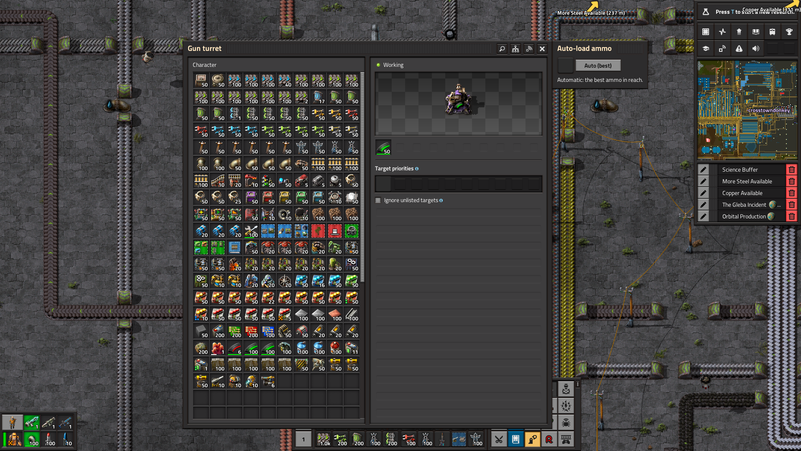

# Smart Turret Ammo (Factorio 2.1 mod)



Gun, rocket, railgun and artillery turrets (and artillery wagons) keep themselves stocked with the best ammo in
reach - no extra entities, no inserters, no interfaces. Works with other mods' turrets and ammo.

- **On planets** construction robots bring ammo from the logistic network.
- **On space platforms** the hub throws it across from its inventory.
- **Upgrades itself:** when the network has a full load of better ammo that no other turret is waiting for, the old
  ammo goes back to storage and the better ammo goes in (on planets, once the turret stops shooting). Better = more
  damage (yellow < red < uranium, rocket < explosive rocket). Quality multiplies damage (+30% a level, legendary
  2.5x), so legendary yellow (12.5 a shot) beats normal red (8); on a tie the higher quality wins.
- **Never left low:** an empty turret takes the best ammo there is a refill's worth of (not two stray rare
  magazines), and a low turret whose ammo has run out in storage swaps to another ammo with a full load to spare.
- **Shares scarce ammo:** a turret never asks for ammo another turret is already waiting for. A request that has
  stalled is cancelled after 20 seconds, so no turret sits empty while other ammo is in storage: stalled = nothing
  delivered, and either its ammo is gone with no robot carrying it, or it is a swap whose old ammo has nowhere to
  go (no storage chest). A swap given up this way isn't tried again on that turret for 5 minutes. Robots still
  flying with the ammo (a far turret, slow early-game robots) are waited for, up to 5 minutes.
- **Leaves your own ammo alone:** personal roboports and spidertrons don't count as a supply (unless you turn that
  setting on), and turrets marked for deconstruction or upgrade aren't filled. Networks without construction
  robots don't count either (a roboport whose robots haven't arrived, a Repair Turret).
- **Modded turrets and ammo just work:** any turret the game calls an ammo turret or artillery is handled (except
  hidden, unselectable ones that other mods use as internal parts), and every ammo item from every mod is scored by
  its damage while the game loads (`data-final-fixes.lua`, following projectiles, artillery shells, clusters and
  nested effects; area damage is weighted by its radius). Ammo another mod adds in its own `data-final-fixes`
  after this one is never loaded automatically (its danger can't be checked); its name goes into
  `factorio-current.log`, and `set_ammo_score` can allow it.
- **With or without Space Age:** works in the base game alone, without the Quality mod, and with Space Exploration
  or Krastorio 2. "Use ammo from other mods: off" keeps every ammo made by the base game, Space Age, Quality and
  Elevated Rails (cannon and shotgun shells, tesla ammo too).
- **Pick the ammo yourself:** open a turret and use the **Auto-load ammo** panel beside its window - an ammo picker
  (only ammo that turret can fire, with quality) and an **Auto (best)** button. A picked ammo is the only one loaded;
  anything else is swapped out. Copy / paste settings copies the choice, blueprints remember it, and so do quality
  upgrades and turrets rebuilt from their ghost after being destroyed. A pick whose ammo is blocked (a setting or
  another mod) is set aside: the turret keeps the ammo it has, then gets the best allowed ammo, until the pick's ammo
  is allowed again. A blueprint pick with a quality this game doesn't have means normal quality.
- **Safe:** ammo that makes a nuclear explosion, spawns units (capture robot rockets, biter-spawning rounds) or has a
  blast wider than 10 tiles is never used - from any mod, including blasts hidden in the explosion an ammo creates
  (Cerys' neutron bomb). Ammo whose harm comes from another mod's script is on a short built-in list (Space
  Exploration's plague bomb). Ammo loaded by hand that the mod won't use is left alone.

## How it works
Turrets are checked in rotation (at most once a second each, and at most N per tick). For a turret that is empty,
low, or holding worse ammo than is available, the mod creates an *item request proxy* - the same request a
blueprint makes for modules - and the game's own robots / platform hub deliver it. A full turret that found nothing
better looks for better ammo again after 10 seconds. A request the mod didn't make but that asks only for ammo (a
cloned turret's, a blueprint's) is looked after like its own.

## Settings (map settings)
| Setting | Default |
|---|---|
| Ammo to keep in each turret (capped at one stack) | 20 |
| Refill when below (% of the amount kept) | 40 |
| Swap worse ammo for better ammo | on |
| Pause requests while a turret is shooting | off |
| Skip turrets fed by inserters | on |
| Use ammo carried by players and spidertrons | off |
| Turrets checked per tick | 20 |
| Use ammo from other mods | on |
| Never use these ammo items (comma-separated names) | (empty) |

## For other mods
```lua
remote.call("smart-turret-ammo", "set_ammo_score", "my-ammo", 30)    -- use it, as if it did 30 damage
remote.call("smart-turret-ammo", "set_ammo_score", "my-ammo", false) -- never use it
remote.call("smart-turret-ammo", "set_ammo_score", "my-ammo", nil)   -- back to the automatic score
remote.call("smart-turret-ammo", "get_ammo_info", "my-ammo")         -- {score, danger, allowed}
remote.call("smart-turret-ammo", "set_turret_ammo", turret, "piercing-rounds-magazine", "normal") -- lock one turret
remote.call("smart-turret-ammo", "set_turret_ammo", turret, nil)     -- back to automatic
```

## Development
- `tools/run_tests.sh [suite ...]` - runs the test suites headless in a throwaway folder on a fixed, enemy-free map
  and prints PASS / FAIL for each behaviour: 7 suites, 86 checks. It never touches `~/.factorio`.
  - `main` (55 checks): `tests/sta-tests` - the original checks, `qa.lua` (the 0.1.1 QA pass: scarce ammo, one load
    for many swaps, vanished ammo, personal roboports, deconstruction, re-picking, a long fight, quality upgrades,
    rebuilt turrets) and `qa2.lua` (the 0.1.2 pass: robot-less networks, stuck swaps, slow far robots, quality
    trickles, low turrets, picked walls, quality ranking, neutron-bomb-style shells, cloned and unregistered
    turrets, hidden turrets).
  - `baseonly` (5): the base game alone, no Space Age, no Quality mod. `settings` (6): map settings changed from
    their defaults ("Use ammo from other mods" off) and a blocked pick. `badpicks` (3): picks with an unknown
    quality or a damaged blueprint tag. `removed` (3): a save picked to an ammo mod's ammo, loaded without that mod.
    These live in `tests/sta-suites` (with `scenes.lua`, the shared scene builders); `tests/sta-removed-ammo` is the
    ammo mod that `removed` takes away. `upgrade` (7) and `upgrade010` (7): a save made by 0.1.1 / 0.1.0 (from git) in
    the middle of the action - open requests, half-done swaps, scarce ammo, picks, robots in the air - loaded with the
    current code: picks kept, every turret filled, no stuck request (`UPGRADE_FROM=<folder or zip>` starts from
    another build).
  - `tests/sta-fake-content` is a pretend other mod (a laser turret, laser rounds, a "mega nuke", a biter-spawning
    round, a neutron-bomb-style shell, a cannon turret, a hidden turret).
  - Options: `EXTRA_MODS="<zip or folder> ..."` (or `EXTRA_MODS_FILE=<one path per line>`) also loads other mods,
    linked read-only - e.g. your own mod set; `STA_SRC=<folder or zip>` tests another build (say
    `dist/smart-turret-ammo_0.1.1.zip`); `KEEP=1` keeps the throwaway folder. Exit status 0 only if every suite passed.
- `tools/package.sh` - builds `dist/smart-turret-ammo_<version>.zip` for the mod portal.

## License
MIT - see [LICENSE](LICENSE).

Questions, bug reports or ideas: come and chat on the [Donkeywork Games Discord](https://discord.gg/AabyFdsP5p) (#mod-bugs for bugs).
